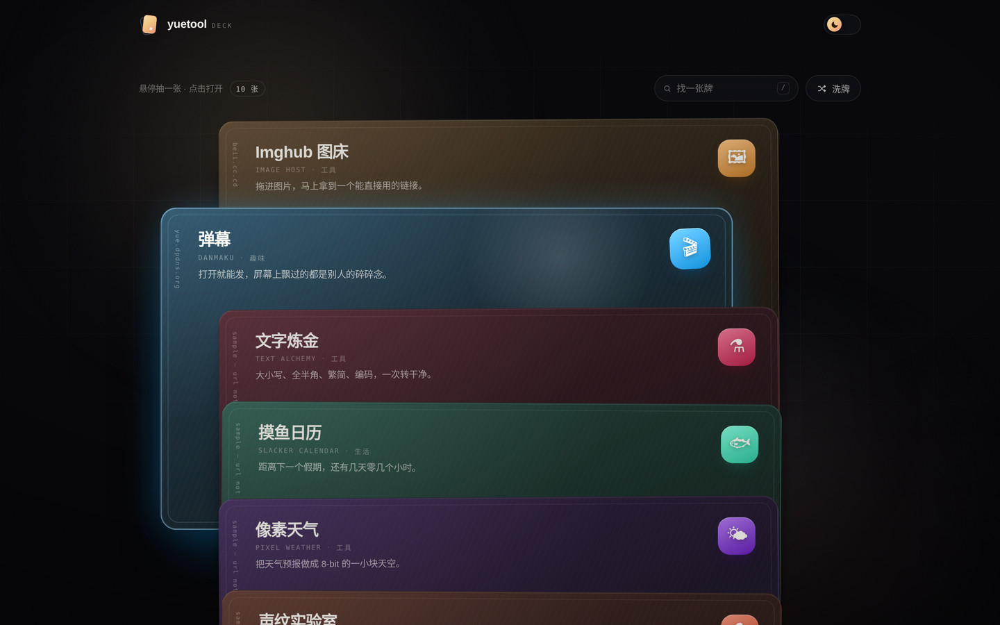

# yuetool · 牌堆

一个「把作品收成一叠牌」的个人站点。纵向叠放，只露出每张牌的顶部一条；鼠标悬停时整张牌向左抽出，点击打开对应项目。

参考了 [Lollipop8555.github.io](https://github.com/Lollipop8555/Lollipop8555.github.io) 的牌堆交互，代码、配色与版式均为重新实现。

- **Vue 3 + Vite**，无 UI 框架，CSS 全部手写
- **双主题**：跟随系统，手动切换记忆到 localStorage
- **搜索 / 洗牌 / 键盘导航**：`/` 搜索、`↑↓` 换牌、`Enter` 打开、`Esc` 清空
- **响应式**：≥900px 横版 16:9 牌；窄屏竖版 9:16 牌，说明牌自动收成 3:4
- **可访问性**：`prefers-reduced-motion`、可见焦点环、链接语义与 aria-label



## 快速开始

```bash
npm install
npm run dev      # http://localhost:5173
npm run build    # 产物在 dist/
npm run preview  # 本地预览构建结果
```

## 改内容：只动一个文件

站点文案、社交链接、卡片清单都在 [`src/data/site.js`](src/data/site.js)。

```js
export const site = {
  name: 'yuetool',               // 品牌名，导航与页脚
  hint: '悬停抽一张 · 点击打开',  // 工具栏左侧的小字
  github: '',                    // 留空则不显示 GitHub 入口
  email: '',                     // 留空则不显示邮件入口
  about: { /* 最后那张说明牌的内容 */ }
}
```

一张牌支持这些字段：

| 字段     | 必填 | 说明                                                        |
| -------- | ---- | ----------------------------------------------------------- |
| `id`     | 是   | 唯一标识，用于动画 key                                      |
| `name`   | 是   | 卡片正面的大字                                              |
| `en`     | 否   | 英文名，显示在名字下方                                      |
| `tag`    | 否   | 一个词的分类，如「工具」                                    |
| `desc`   | 否   | 一句话介绍（窄屏自动隐藏）                                  |
| `url`    | 否   | 点击跳转地址。**留空即为示例牌**，点击只弹提示，不会跳走    |
| `emoji`  | 否   | 图标；也可用 `icon: '/icons/foo.png'` 换成图片              |
| `hue`    | 否   | 主色相 0–360，不写则按 12 色轮转自动分配                    |

新增一张牌 = 在 `SAMPLES` 数组里加一个对象，不需要碰任何组件。

站点标题、描述、社交预览图写在 `index.html` 的 `<title>` / `<meta>` 里；`og:image` 上线后建议改成完整地址（`https://你的域名/og.jpg`），部分平台只认绝对路径。

## 改视觉

- 颜色令牌、字体、圆角、动效时长：`src/styles.css` 顶部的 `:root` 与两个主题块
- 卡片比例、露出比例、抽出距离：`src/components/Deck.vue` 里的 `--card-rw / --card-rh / --band`，以及 `src/styles/card.css` 的 `--lift`
- 没把握的时候优先改色相 `--hue`，整张卡（底纹、边框、图标、序号）会一起变

## 部署到 GitHub Pages

### 1. 建仓库

- 想要 `https://<你的用户名>.github.io/` → 仓库名必须是 `<你的用户名>.github.io`
- 想要 `https://<你的用户名>.github.io/<仓库名>/` → 任意仓库名即可

构建默认用相对路径（`base: './'`），所以同一份产物在 `/<仓库名>/` 子路径和自有域名根路径下都能直接加载，**不需要为项目主页额外配置**。

### 2. 推代码

```bash
git init
git add .
git commit -m "init: yuetool deck"
git branch -M main
git remote add origin git@github.com:<用户名>/<仓库名>.git
git push -u origin main
```

### 3. 打开 Actions 部署

仓库 **Settings → Pages → Build and deployment → Source** 选 **GitHub Actions**。之后每次 push 到 `main`，[`.github/workflows/deploy.yml`](.github/workflows/deploy.yml) 会自动构建 `dist/` 并发布。

> 注意：Pages 发布的是构建产物 `dist/`，不是仓库根目录。若手动改成 "Deploy from a branch" 并指向根目录，线上会加载未编译的 `src/main.js`，页面一片空白。

### 4. 绑定自己的域名

在仓库 **Settings → Pages → Custom domain** 填入域名（例如 `example.com`），保存后等待 DNS 检查通过，再勾选 **Enforce HTTPS**。

解析记录按「域名是主域还是子域」来选：

**子域（如 `www.example.com`）——用 CNAME 就够了**

| 类型  | 主机记录 | 记录值                  |
| ----- | -------- | ----------------------- |
| CNAME | `www`    | `yourname.github.io.`   |

> 主机记录填 `www`（服务商要求全名时填 `www.example.com`），值不要带 `/your-repo/` 之类的路径。

**主域（如 `example.com`）——用 A 记录**

| 类型  | 主机记录 | 记录值                                          |
| ----- | -------- | ----------------------------------------------- |
| A     | `@`      | `185.199.108.153`                               |
| A     | `@`      | `185.199.109.153`                               |
| A     | `@`      | `185.199.110.153`                               |
| A     | `@`      | `185.199.111.153`                               |
| CNAME | `www`    | `<用户名>.github.io.`                           |

配置完成后，原来的 `https://<用户名>.github.io/<仓库名>/` 会自动 301 跳转到自定义域名，两者不会各显示一份。

- 用 Cloudflare 托管时，把相关记录的**代理（橙色小云）关掉**，否则 GitHub 签不出证书。
- DNS 生效通常几分钟到几小时；证书签发要等 Pages 里出现绿色勾。
- 也可以不点设置页，直接在仓库 Variables 里加 `CUSTOM_DOMAIN=example.com`，工作流会把 `CNAME` 写进产物；两种方式选一种即可。

## 目录结构

```
yuetool-deck/
├─ src/
│  ├─ components/
│  │  ├─ NavBar.vue          顶栏：双牌字标、GitHub、主题开关
│  │  ├─ DeckIntro.vue       工具条：提示、搜索、洗牌
│  │  ├─ Deck.vue            牌堆容器、键盘导航、空状态
│  │  ├─ DeckCard.vue        单张牌
│  │  ├─ ColophonCard.vue    最后一张说明牌
│  │  ├─ BackgroundFX.vue    背景光斑、网格、颗粒
│  │  └─ ToastHost.vue       底部提示条
│  ├─ composables/           主题、鼠标、提示
│  ├─ data/site.js           站点与卡片内容
│  ├─ styles.css             设计令牌与基础样式
│  ├─ styles/card.css        卡片与说明牌样式
│  ├─ App.vue
│  └─ main.js
├─ public/                   favicon、robots、og 图
├─ .github/workflows/deploy.yml
└─ vite.config.js
```

## 小提示

- **示例牌**：`URL` 为空时点击会提示去哪改，填上地址后自动变成正常链接，示例提示消失。
- **洗牌**：只打乱当前浏览顺序，不改源数据；刷新页面恢复原顺序。
- **搜索**：匹配名称、英文名、分类和简介；无结果时显示空牌位和「清空搜索」。
- **深色闪白**：`index.html` 头部有一段内联脚本，在首屏渲染前就把主题写到 `<html data-theme>`，不会闪。
- **OG 图**：`public/og.png` 是分享预览图，换成自己的截图即可；`og:image` 建议写完整 URL（含域名）。

## License

MIT，见 [LICENSE](LICENSE)。卡片里放什么、牌子叫什么，随你。
